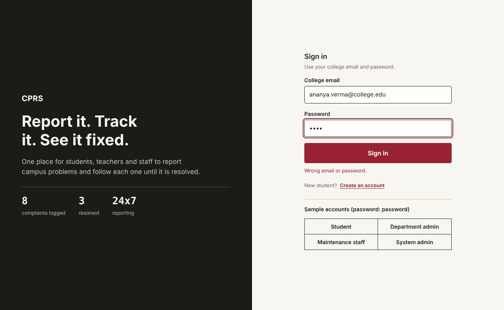
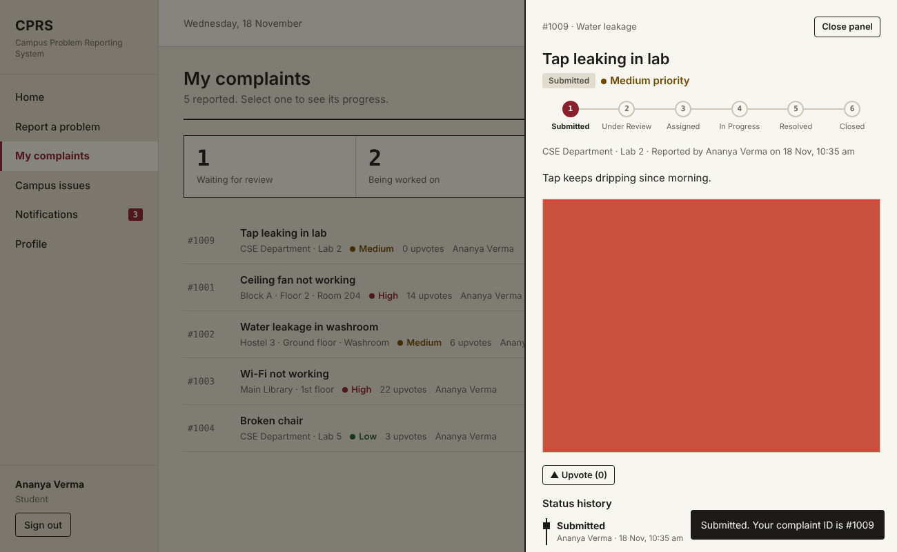
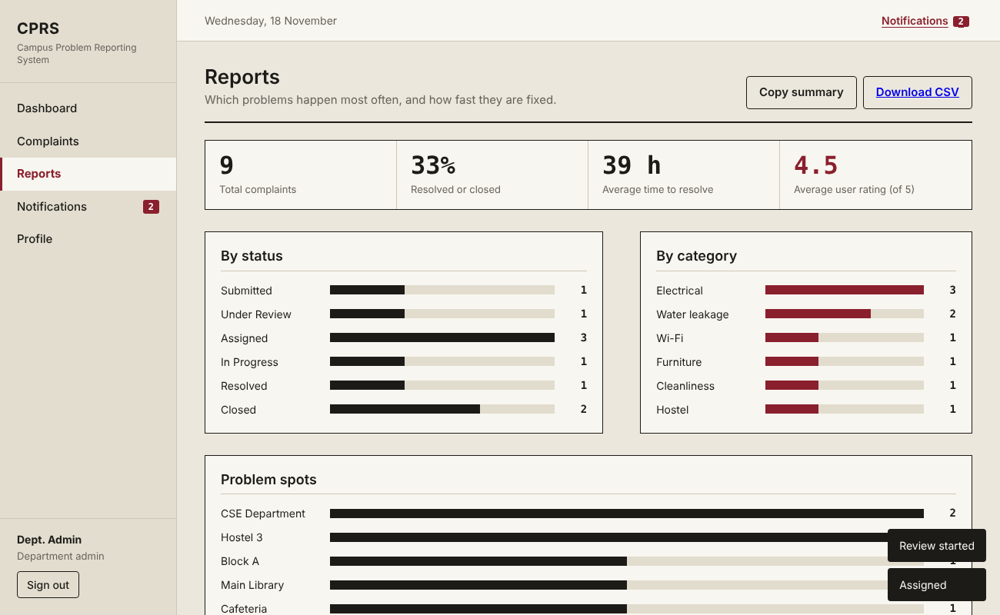

# Campus Problem Reporting System (CPRS)

A website where students report problems on campus (broken fans, leaking taps, Wi-Fi, furniture, cleanliness) and follow each one until it is fixed. Built as the Software Engineering course project at Punjab Engineering College (Deemed to be University), Chandigarh.

**Team:** Kalash Deep (24103111), Shivansh Chauhan (24103114), Pradyuman Thakur (24103117)
**Submitted to:** Prof. Tejinder Paul Kaur, Department of Computer Science and Engineering

## The problem

Students and staff have no single, trackable way to report campus problems, so complaints get lost in calls and chat groups and the person who reported them never learns what happened. CPRS gives every complaint an ID, a status and a history.

## Features

- **Students:** report a problem with category, location, priority, photo and an anonymous option; get a warning about similar open issues; track status; upvote and comment; rate the fix (1 to 5) and close or reopen the complaint
- **Department admin:** dashboard, review complaints, set priority, assign maintenance staff, mark duplicates, reports with charts, CSV download
- **Maintenance staff:** see assigned work, start it, mark it resolved
- **System admin:** add and remove users, edit categories and departments
- Real sign-in (passwords are hashed), with every action checked on the server by role
- Notifications with settings, light and dark theme, works on phones

Status flow: Submitted → Under Review → Assigned → In Progress → Resolved → Closed

## Screenshots

| Sign in | Complaint details | Reports |
|---|---|---|
|  |  |  |

## Run it

You only need [Node.js](https://nodejs.org) 16 or newer. There is nothing to install with npm.

```
node server.js
```

On Windows you can also double-click `start.bat`. Then open http://localhost:3000.

To use it from a phone or another laptop on the same Wi-Fi, open the "On your Wi-Fi" address printed in the terminal.

### Sample accounts

The password for every sample account is `password`.

| Role | Email |
|---|---|
| Student | ananya.verma@college.edu |
| Department admin | admin.estate@college.edu |
| Maintenance staff | harpreet.singh@college.edu |
| System admin | sysadmin@college.edu |

Students can also create their own account from the sign-in page.

To start again with the sample data, stop the server and run `node server.js --reset`.

## How it is built

| Part | Choice |
|---|---|
| Server | Node.js (built-in `http`, no outside packages) |
| Database | One JSON file, `data/db.json`, saved after every change (made on first run) |
| Photos | Saved in `uploads/`, shown only to signed-in users |
| Website | One HTML page with plain JavaScript, no framework |
| Sign-in | scrypt password hashing, HttpOnly session cookie |

```
server.js           the server and the API
public/index.html   the website
data/db.json        the database (created on first run, not in git)
uploads/            complaint photos (created on first run, not in git)
docs/               the final project report and screenshots
```

## Limits

- Notifications are shown inside the website only. No emails are sent.
- The JSON file database suits a small campus demo. A larger deployment would move to a database such as PostgreSQL.
- It runs over plain HTTP, which is fine on a private network. Put it behind HTTPS before using it on the internet.
